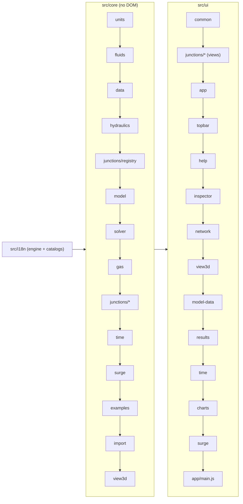

# Architecture

Pump It is a static web app: plain HTML, CSS and JavaScript with no build step and no dependencies, so `index.html` opens straight from disk. The code is organised in **blocks** (folders) with small files, so that different people can work on different blocks at the same time without editing the same files.

## Principles

- **One global namespace.** Every file is a classic script wrapped in an IIFE that attaches its module to `PumpIt` (core) or `PumpIt.ui` (interface). The application controller is `PumpIt.app`.
- **`index.html` is the manifest.** It lists every script and stylesheet in load order, grouped by block. The Node tests read the core part of that list (`tests/load-core.js`), and `npm run build` copies every file of it into the single-file build (`tools/build-standalone.cjs`), so a new file only has to be added there.
- **The core has no DOM.** Everything under `src/core/` runs in Node and in the browser. Values are SI inside the core; units are converted only at input and output.
- **Registries instead of switches.** Junction types, fluids, examples, pipe catalogues and file importers register themselves. Generic code never tests for a specific junction type or pipe material: it reads the type's definition (core) or view (interface), or the catalogue's definition.
- **No text in the code.** Everything the user reads comes from the message catalogs (`src/i18n/<language>/`), by key; the code, its comments and the keys are in English.

## Blocks and load order



| Block | Folder | Namespace | Content |
| --- | --- | --- | --- |
| Languages | `src/i18n/` | `PumpIt.i18n` | Message catalogs per language and block, `t(key, params)`, current language, number locale |
| Units | `src/core/units.js` | `PumpIt.units` | Unit categories, conversion to and from SI, unit labels, and the conversion of a value to another unit of its category (`convert`, with `convertNeeds` saying what it lacks: the ambient pressure or a density) |
| Fluids | `src/core/fluids/` | `PumpIt.fluids` | Fluid library (`register`, `evaluate`); water from public correlations; the gases of the compressible mode (`GASES`, `evaluateGas`, Sutherland, normal density) |
| Engineering data | `src/core/data/` | `PumpIt.data` | Pipe catalogues (carbon and stainless steel, HDPE, ductile iron), one file each, registered in `pipe-library.js` (`registerPipes`, `pipeDims`, `fitMaterial`; see [pipe-library.md](pipe-library.md)), roughness, fittings (Crane), water velocity bands |
| Hydraulics | `src/core/hydraulics/` | `PumpIt.hyd` | Friction factors, curve fitting, local loss coefficients |
| Model | `src/core/model/` | `PumpIt.model` | Factories (`newModel`, `newPipe`, `newJunction`, `pipeDefaults`), scenarios, checklist (`validate`), drawing-only fields (`LAYOUT_KEYS`, `stripLayout`, `normalizeLayout`), the ends of pipes (`connectEnd`, `loosenEnd`, `spotNear`, `normalizeEnds`: an end may be loose, see [pipe-ends.md](pipe-ends.md)) |
| Solver | `src/core/solver/` | `PumpIt.solver` | `run`, `prepare`, `systemCurve` and the internal stages |
| Compressible mode | `src/core/gas/` | `PumpIt.gas` | The reference physics of gas flow (`gas.js`, appendix A of its specification), the flow relations of the links (`flow.js`), the gas network of a model (`network.js`), Newton on the node pressures (`newton.js`), results (`results.js`) and `solveModelGas` (`solver.js`); see [gas-decisions.md](gas-decisions.md) |
| Junction types | `src/core/junctions/` | `PumpIt.junctionTypes` | Registry and one file per type |
| Time simulation | `src/core/time/` | `PumpIt.time` | Quasi-static runs: the tables of the junctions (`tables.js`), conditions, triggers and the named events of the model (`events.js`), finite tanks, open or closed (`tanks.js`), the gas vessels of the compressible mode, with their thermal model and their table of heat and volume (`vessels.js`), the energy cost of the pumps (`cost.js`), the model of a step (`inputs.js`), the record of a run (`record.js`) and the main loop `run` / `start`, with the implicit step of the vessels (`simulate.js`); see [time-simulation.md](time-simulation.md) |
| Examples | `src/core/examples/` | `PumpIt.examples` | Builder helpers and one file per example |
| Water hammer | `src/core/surge/` | `PumpIt.surge` | A module of its own, off until the user turns it on: the elastic transient of a liquid network by the method of characteristics. The wave speeds (`wavespeed.js`), the sectioning (`sectioning.js`), the pipes and their cavities (`moc.js`), the generic boundaries of the junctions and the scalar roots (`boundaries.js`), the pumps, their trips, starts and four quadrants (`pumps.js`), the dynamic check valves (`checks.js`), the protection devices, the infinite pipe and the finite reservoir (`devices.js`), the unbalanced forces (`forces.js`), the control, the data of the junctions and the checklist (`inputs.js`), the network of a run from the refined steady state (`network.js`), the record of a run (`record.js`) and the main loop `run` / `start` (`simulate.js`); see [water-hammer.md](water-hammer.md) |
| Import | `src/core/import/` | `PumpIt.importers`, `PumpIt.importShared` | Readers of model files of other formats, one per file extension: `.fth` for liquids, `.aro` for gases and `.imp` for transients of liquids (the format descriptions of the specification team; docs/fth-import.md, docs/aro-import.md, docs/imp-import.md) → the scenarios of the file, a model of one of them, the notes of the import (what needs input, was assumed, left out or read) and the comparison with the results stored in the file. What the two formats share (sections, records, scenarios, units, notes, drawing positions, comparison, and the readers of the time control and of the blocks of time data) is `shared.js`. The network of a liquid is read by `liquid.js` (`PumpIt.importLiquid`) for `.fth` and `.imp` files, each format giving it what is its own; the blocks of the junctions of `.imp` files are read and merged item by item by `items.js` (`PumpIt.importItems`), and their data of the water hammer go to the fields of its module through `imp-surge.js` (`PumpIt.importImpSurge`), only while that module is in the page |
| 3D view geometry | `src/core/view3d/` | `PumpIt.view3d` | Camera and projection, navigation, the grid, pipe routes that follow their ends, symbol orientation, scene points from the plan and the elevation, editing, the junction symbols as solids, the view cube (pure functions; see [3D-VIEWS.md](3D-VIEWS.md)) |
| Common UI | `src/ui/common/` | `PumpIt.ui.format`, `.pipeLabels`, `.dom`, `.dialogs`, `.tips`, `.focusKeep`, `.download`, `.xlsx` | Formatting, the designations of catalogue pipes, DOM helpers, dialogs (they keep the focus inside while open and give it back to the control that opened them), the bubble of the notes (the "i" of the fields, and the note of an input unit while it has the focus), the focus kept while a panel is drawn again, downloads, .xlsx writer |
| Junction views | `src/ui/junctions/` | `PumpIt.ui.junctionTypes` | Registry and one view per type |
| Application | `src/ui/app/` | `PumpIt.app` | State, selection, editing and undo, clipboard, calculation, files (open `.json`, or another format through the importer of its extension; files dropped on the window), the import report, layout, keyboard, start-up |
| Top bar | `src/ui/topbar/` | `PumpIt.ui.menus`, `.shortcuts`, `.header`, `.scenarios`, `.checklist`, `.language`, `.theme` | Menus and commands (the Options menu adds its own, `options.js`), keyboard shortcuts box, header status and the stamp of the regime, scenarios, checklist, language selector, light and dark mode button |
| Help | `src/ui/help/` | `PumpIt.ui.help`, `.tour`, `.helpEquations` | The help window (chapters, search, links that light areas of the screen), the guided tour and the formulas of the technical reference |
| Inspector | `src/ui/inspector/` | `PumpIt.ui.inspector`, `.forms`, `.systemForm`, `.systemWindow`, `.valueConvert`, `.pending`, ... | Field builders (with their notes, and beside each unit the command that converts the value), the pending items of an object tied to its fields (the checklist takes the focus there, and the panel marks them), one file per panel, the drawing of a reservoir (`.reservoirDrawing`: the tank cut through, with the elevations of its fields), the opening and collapsing of the panel, which follows the selection (and its arrow), and the system window: the properties of the system in a window over the page, with a summary in the panel when nothing is selected |
| Network view | `src/ui/network/` | `PumpIt.ui.canvas`, `.drawing`, `.colorScales`, `.palette`, `.infoCard`, `.fullScreen` | Interaction, SVG drawing, colour scales, palette (with the arrow that collapses it), right-click card, full screen (only the drawing, the palette and the properties panel) |
| 3D view | `src/ui/view3d/` | `PumpIt.ui.scene3d`, `.commands3d`, `.edit3d` (with `.freeEdit3d`), `.solids3d`, `.render3d`, `.quick3d`, `.nav3d`, `.hud3d`, `.cube3d` | Scene (plan and elevation), commands, editing, the junction symbols as shaded solids, SVG drawing with depth cues and quick frames while something moves, camera navigation and glides, view switch with the menu of the view, the view cube, inspector sections (see [3D-VIEWS.md](3D-VIEWS.md)) |
| Model data view | `src/ui/model-data/` | `PumpIt.ui.modelData` | Input tables |
| Results view | `src/ui/results/` | `PumpIt.ui.results`, `.resultCatalog`, `.columnSetup`, `.resultColumns`, `.columnWindow`, `.resultExport` | The outputs each table can show (no DOM), the columns chosen for a liquid and for a gas with their units and the templates of the profile, result tables, the column window, warnings, TSV and Excel export (a sheet per table); see [result-outputs.md](result-outputs.md) |
| Time simulation (interface) | `src/ui/time/` | `PumpIt.ui.timeBar`, `.timeSystem`, `.timeEvents`, `.timeData`, `.pointTable`, `.timeResults`, `.timeFormat` | The run in slices after the steady state and the time cursor (`run.js`, on `PumpIt.app`), the stamp and the cursor bar, the section of the system window with the tariff and the named events of the model (`events-section.js`), the time data and the tank or gas vessel of a junction (inspector sections), the result tabs, the model data and the `.xlsx` sheets |
| Charts view | `src/ui/charts/` | `PumpIt.ui.charts`, `.lineChart`, `.pumpChart`, `.profileChart`, `.timeChart` | Charts; another block adds a chart with its tab through `charts.register(kind, { render, visible, label, bind })` |
| Water hammer (interface) | `src/ui/surge/` | `PumpIt.ui.surgeBar`, `.surgeSystem`, `.surgeData`, `.surgeResults`, `.surgeCharts`, `.surgeFormat` | The run in slices after the steady state and its time cursor (`run.js`, on `PumpIt.app`), the stamp and the cursor bar, made by the script itself (`bar.js`), its section of the system window with the sectioning and the events of the model (`system.js`), the wave of a pipe and the data of a junction (inspector sections), the result tabs and the `.xlsx` sheets (`results.js`), its colours of the drawing (`overlay.js`) and its two charts (`charts.js`). The page works without these files |
| Styles | `src/ui/styles/` | — | One stylesheet per block, in cascade order |

Load-order rules: a file may use, **at load time**, only modules listed before it in `index.html`; anything used later (inside functions) only needs to exist by the time it is called. `src/ui/app/main.js` is always last: it binds every block to the page on `DOMContentLoaded`. The one script out of its group is `src/ui/topbar/theme.js`, loaded before the page body so that a light or dark mode chosen earlier is set (as `data-theme` on `<html>`, read by `tokens.css`) before the first paint; at load time it uses only the browser.

## Data flow

1. **Edit.** A panel calls `app.setVal(key, path, value)` (or another command in `src/ui/app/editing.js`). The command pushes an undo snapshot and writes through `PumpIt.model.setField`, which applies the scenario rule: the base scenario holds every value, a child scenario stores only the attributes that differ from its parent. A field inside a block the child overrides whole (an override of `friction` or of `pipeK.1`) first splits the block into overrides of the fields that differ from the parent, so the others follow the parent again; a file saved with such blocks is split the same way when it opens (`splitBlocksOnLoad`). An edit of the material or the section of a pipe also sets the scenarios below it by the catalogue rules (`fitPipesBelow` in `src/core/model/pipe-scenarios.js`, decisions P-09 to P-11 of [pipe-library.md](pipe-library.md)); a section of a scenario's own that an inherited catalogue material covers is kept dormant in the scenario (`parked`). The paths of the overrides and of the dormant sections come from files too, so `PumpIt.model.setPath` writes nothing through `__proto__`, `prototype` or `constructor`. Changing the type of a junction keeps, in the base and in every scenario, the name, the elevation, the losses at the pipes, a loss model the new type accepts (`lossModels` of its definition) and, between two valve types, the coefficients the new type has (`keepsOnRetype`).
2. **Recalculate.** `app.changed()` increments `app.version`, clears every result, saves the model to the browser and calls `app.recalc()`: if the checklist (`PumpIt.model.validate`) of the current scenario is complete, `PumpIt.solver.run(app.eff())` calculates it.
3. **Render.** `app.renderAll()` redraws the header, the drawing, the inspector, the system window (when open) and the visible view. Panels read `app.eff()` (effective model of the current scenario) and `app.okResults()`. Another model in place of the one open (`app.replaceModel`: a file opened or dropped, a pasted model, a new model or an example) first confirms the field being edited into the model before, which becomes the undo step; once the new model is in, `app.modelGen` grows by one, the dialogs and menus close, and a field, a cell or a dialog built for the model before writes nothing into the new one. Of two files requested one after the other, only the latest applies, whichever reading ends first.
4. **Time simulation.** With `solution.time.on`, `app.recalc()` then starts the run of the scenario (`PumpIt.time.start`), which goes on in slices of about 30 ms; any edit cancels it. Once it has recorded steps, `app.currentResults()` gives the step of the time cursor, solved again from its snapshot, so every panel shows that step without knowing about time.
5. **Water hammer.** With `solution.surge.on` (exclusive with the time simulation), `app.recalc()` then calls `app.startSurge()` (`src/ui/surge/run.js`, when the module is there), which runs `PumpIt.surge.start` in slices of about 30 ms; any edit cancels it. The steady results stay those of every panel (the instant 0 s); the water hammer has its own results (`app.surgeRun()`), cursor (`app.surgeCursor()`), tabs, colours of the drawing and charts.

Drawing fields (`PumpIt.model.LAYOUT_KEYS`: the schematic position, symbol rolls, pipe routes, where the loose ends of pipes lie and the 3D view settings) are not calculation data. They live on the objects of the base model, never in scenario overrides; editing them only pushes an undo snapshot and saves, without recalculating or clearing the results; and the solver works on a copy without them. The 3D views draw every junction at its schematic position and at the height of its elevation, which is calculation data: moving a junction up or down there is an elevation edit, with recalculation.

## Interface languages

`src/i18n/i18n.js` holds the messages of every language and answers `PumpIt.i18n.t(key, params)` in the current one. Each language is a folder with one catalog per block of the app:

```
src/i18n/en/      language.js  core.js  junctions.js  examples.js  app.js  network.js  inspector.js  model-data.js  results.js  charts.js  help.js
src/i18n/pt-BR/   (same files)
src/i18n/es/      (same files)
```

- **Keys** are dotted paths that start with the block: `app.menu.file`, `junctions.pump.form.speed`, `core.solver.notConverged`. Texts may hold `{name}` placeholders, filled by `t(key, { name })`. A text may contain simple HTML (`<sub>`, `<b>`); values put into it are escaped by the caller.
- **English (`en`) is the base language.** Every key must exist there; a key missing in another language falls back to the English text (and `tests/check-i18n.js` fails). It is also the language of a browser whose own language is not supported, and the language of the texts written in `index.html` before `src/ui/topbar/language.js` applies the current one.
- **Static page texts** in `index.html` carry `data-i18n="key"` (element text) or `data-i18n-title`, `-aria-label`, `-placeholder`, `-content` (attributes); `src/ui/topbar/language.js` applies them.
- **The core uses the same catalogs** for what it produces (checklist items, warnings, valve states, example models). Results therefore come out in the current language, and a language change recalculates.
- **Numbers** are formatted with the number locale of the language (`PumpIt.ui.format`); unit symbols are shown through `PumpIt.units.label` (catalog `core.units.label`).
- Junction type names come from `junctions.<type>.label`, example names from `examples.<id>.name`; fluids, fittings and roughness presets read their names from `core.*` by id.

Changing the language (`app.setLanguage`, in `src/ui/topbar/language.js`): switch the catalog, save the preference, apply the page texts, rebuild the examples menu and the palette, rebuild an untouched example, clear the results, recalculate and redraw.

## Solver pipeline

`PumpIt.solver.run(eff)` (`src/core/solver/solver.js`) first takes a copy of `eff` without the drawing fields (`PumpIt.model.stripLayout`). A model in the compressible regime (`system.regime === 'compressible'`) goes to `PumpIt.gas.solveModelGas` (below); otherwise:

1. `prepare` (`network.js`): fluid properties, pipes in SI, nodes and links. Single-node junction types create their node through `buildNode`; two-port types become an element link filled by `buildElement`.
2. Device loop, until the device states settle: `configure` (`devices.js`) → `analyze` (`connectivity.js`, pressure references and isolated parts) → `newton` (`newton.js`, link mass flows and node pressures solved together) → `review` (`devices.js`).
3. `postprocess` (`results.js`): pipe, junction, pump and valve results and the warnings; type-specific results come from `nodeResults` / `elementResults`.

### Compressible mode

`PumpIt.gas.solveModelGas(eff)` (`src/core/gas/solver.js`) follows the same pipeline with its own stages:

1. `prepare` (`network.js`): the gas and its context (thermal model, gravity), pipes in SI (`PumpIt.solver.pipeData`, shared with the liquid), nodes and links built by the `gas` hooks of the junction types. A node carries the kind of its pressure (static or stagnation); a link carries a relation (a duct, a nozzle, a curve) or a row of its own (`con`: a set pressure, a ratio, a tie, a flow given as a volume).
2. Device loop, reusing `configure`, `analyze` and `review` of the solver: Newton on the free node pressures (`newton.js`), where every ordinary link gives its mass flow from its two nodes (`flow.js`: inlet state, closed isothermal form, march, Fanno, choking, the inverse problem and its derivatives). The adiabatic model wraps the Newton in the loop of the node temperatures and starts from the isothermal solution. The first pressures come from the linear theory of gas networks on P².
3. `postprocess` (`results.js`): the results of a gas in the shape of the liquid ones, with the fields of a gas, and the warnings; type-specific results come from `gas.results`.

## Extension points

### A new junction type

1. `src/core/junctions/<type>.js`: `PumpIt.junctionTypes.register({ ... })` following the contract at the top of `src/core/junctions/registry.js` (defaults, checklist, network equations, results, and the `gas` hooks of the compressible mode — without them the type is refused in that mode).
2. `src/ui/junctions/<type>.js`: `PumpIt.ui.junctionTypes.register('<type>', { ... })` following the contract at the top of `src/ui/junctions/registry.js` (symbol, the solid of the 3D views, inspector form, summaries, result rows).
3. Its texts under `junctions.<type>` in `src/i18n/<language>/junctions.js` of every language (at least `label`).
4. Add both `<script>` tags to their groups in `index.html`.

The palette, the type selector, the checklist, the solver, the tables, the right-click card and the drawing pick the new type up from the registries.

### Time data of a junction type

A type takes time data through its `time` hook (contract in `src/core/junctions/registry.js`): `quantities(j)` lists what a table can drive in the current mode of the junction (unit category, steady value, how a value is written into the model of a step, an optional interpolation space and domain), and the optional fields say whether it is a pump or a valve for the results and the conditions (`results`, `states`, `stateOf`, `log`, `isOn`, `isClosed`), a valve that gives its opening (`opening`), a pump with a check valve (`checkOf`), a reservoir that may be a finite tank or a gas vessel (`tank`) or an imposed flow (`imposedFlow`). `quantities(j, { gas })` may answer differently in the compressible mode. A device of the solver with states (a check valve) carries `device.anyway` to be reviewed also after a solution that did not converge (`src/core/solver/devices.js`). The inspector section, the checklist, the conditions and the run pick it up from there; the generic code never tests a type.

### Water hammer of a junction type

A type takes part in the water hammer through its `surge` hook (contract in `src/core/junctions/registry.js`): `quantities(j)` lists what a table of the water hammer can drive (as `time.quantities`; without the hook, those of the time simulation), `boundary(j, ctx)` gives a boundary of its own (the pump, a check valve with a dynamic model and the protection devices do; `null` leaves the generic one, as an infinite reservoir or an instantaneous check valve does), `validate(j, miss, v)` adds its own fields to the checklist, and `outflowOnly`, `frozen(j)` and `reopens` say that a discharge takes no liquid in (a nozzle), that a control device keeps the loss of its steady state instead of controlling, and that a device closed by its special condition may open in the transient. Without the hook a type gets the generic boundary of its shape: a node (fixed or free pressure, with its discharges) or an element with the loss law and the devices of the steady state. A boundary gives `fields` and writes their values, in that order, into an array (`values(o)`), which the results record; it may also give `totals()` (volumes of the whole run, as the overflow of a tank) and `tank()` (the level and volume the conditions of events read). Its view (`src/ui/junctions/<type>.js`) may add fields to the water hammer section of the inspector with `surge(section, ctx)`. A type that only makes sense with a module, as the protection devices of the water hammer (palette group `protection`), gives `offered()`: the palette and the type selector show it only while that answers true (here, while the module is in the page); a model that has one keeps it either way.

### A new language

1. Copy `src/i18n/en/` to `src/i18n/<code>/` (for example `fr`) and translate the texts, keeping keys and `{placeholders}`.
2. In `language.js`, register the language with its own name and number locale: `PumpIt.i18n.register('fr', { name: 'Français', numberLocale: 'fr-FR' })`.
3. Add the `<script>` tags of the folder to the "Languages" group of `index.html`, in the same order as the other languages.
4. Run `npm test`: `tests/check-i18n.js` lists any missing or extra key and any placeholder mismatch.

The selector in the top bar lists the new language automatically.

### New texts

Never write a user-facing text in the code: add a key to the block's catalog in **every** language folder (en first) and call `t('block.key', params)`. For a text in `index.html`, add a `data-i18n` attribute. `npm test` checks that every key used literally in the code exists.

### A new fluid

Add `src/core/fluids/<fluid>.js` calling `PumpIt.fluids.register(kind, { label, range, sources, rho, mu, pv })` (functions of the temperature in °C, SI results; `label` and `sources` as getters reading the catalogs, like `water.js`), its texts in every language under `core.fluids.<kind>`, and its `<script>` tag after `fluids.js`. The fluid selector and the checklist list library fluids automatically. Use public correlations only.

### A new pipe catalogue

Add `src/core/data/<material>-pipe.js` with the table of its standard, calling `PumpIt.data.registerPipes(kind, { ... })` following the contract at the top of `src/core/data/pipe-library.js` (sizes, series, dimensions, the decimals of the standard, roughness, the kinds of nominal size and of series, grades, defaults), and its `<script>` tag after `pipe-library.js`. Its texts go under `core.data.pipes.materials.<kind>` and `inspector.pipe.materials.<kind>` in every language; a new kind of nominal size, series or grade also needs its designations (`core.data.pipes.size`, `.nominal`, `.series`, `.grades`) and field labels (`inspector.pipe.sizes`, `.series`). The material list, the pipe panel, the designations of the tables and cards, and the change of material pick it up; `npm test` checks its tables and its texts. Cite the standard and the roughness in [pipe-library.md](pipe-library.md) and the README.

### A new import format

Add `src/core/import/<ext>.js` registering `PumpIt.importers.<ext>` (the file extension, in lower case) with `encoding`, `read(text, { name, scenario })` → `{ model, notes, counts, stored }`, `compare(results, stored)`, `noteText(note)` and `LEVELS`, as `fth.js` does, and its `<script>` tag. An importer of a format with scenarios also gives `scenarios(text)` → `[{ n, name, path, description, results }]`: with more than one, the app asks which one to read. File → Open, the file input and file drops choose the importer by the extension, and the import report shows what it read. Its texts go in every language; list the extension in `app.menu.open`. A format of the same family as `.fth`, `.aro` and `.imp` (sections with positional records, scenarios kept as differences) builds on `shared.js` (`PumpIt.importShared`); a format of a liquid network may give the reader of `liquid.js` what is its own, as `fth.js` and `imp.js` do.

### A new example

Add `src/core/examples/<name>.js` calling `PumpIt.examples.register({ id, order, build })`, using the helpers in `PumpIt.examples.builder`, its texts under `examples.<id>` in every language (`name`, `title` and the object names), and its `<script>` tag.

### Result columns, charts and panels

- Result outputs: an entry in `CATALOG` of `src/ui/results/catalog.js` (field or value function, group, unit category) and its header under `results.columns` (liquid) or `results.gasColumns` (gas) in every language. The column window lists it at once; `DEFAULTS` says which outputs a table shows before the user chooses. A value the results of the core do not have is worked out by the entry's `v(row, ctx)`.
- Charts: a new file in `src/ui/charts/`, an entry in `CHARTS` (`charts.js`) and a tab button in `index.html`.
- Inspector panels: `PumpIt.ui.inspector.panels.<name>(host, ...)`, dispatched by `src/ui/inspector/inspector.js`. Another block adds a section after a panel with `PumpIt.ui.inspector.addSection('system' | 'pipe' | 'junction', fn)`, as the 3D views and the water hammer do. The panel of a pipe or a junction has two tabs, Properties and Results: it gets their panes from `inspector.tabs(host)` after its header, fills them (the quick results go to Results, everything else to Properties) and returns them; the sections of other blocks go to Properties.
- Results on the drawing: another block adds a quantity to the selector with `PumpIt.ui.colorScales.addOverlay(key, { cat, label, offered, values, junction, title })`, which the schematic and the 3D view colour like the others (the water hammer adds four).
- Notes of a field or a section (an "i" that shows the text on hover or focus): `info` in the options of the field builders and of `section()` in `src/ui/inspector/forms.js`, or `forms.note(section, html)`. `forms.hint()` is for a line that must stay in sight: a state (an isolated pipe, the fitted curve) or an error.
- Network drawing: in the 3D view, `src/ui/network/canvas.js` hands its pointer events and its drawing over to `src/ui/view3d/`; the schematic keeps its own code.
- Going to an object from a table, a warning or the checklist: `app.gotoKey(key)` selects it, opens its properties and brings it into sight on the drawing (`UI.canvas.show`), moving the view only when it is out of sight.
- A panel drawn again from scratch after every change (as the inspector and the system window are): it calls `UI.focusKeep.defer(host, redraw)` first, and wraps the rebuild in `UI.focusKeep.save(host)` and `UI.focusKeep.restore(state)`, so that Tab, Shift+Tab and a click on another control reach their target; its controls need stable ids (`forms.idOf`).
- Checklist messages: a message of a junction type under `junctions.<type>.check.<field>` names the field the checklist takes the focus to (`src/ui/inspector/pending.js`); a message whose last key part is not a field goes in the tables at the top of that file.

## Tests

- `tests/run-tests.js` (also run by `tests/motor.test.cjs`): the core against independent solutions (analytical or by bisection).
- `tests/gas.test.cjs`: the reference physics of the compressible mode (appendix B of its specification, as given) and the calculation of gas networks against independent solutions.
- `tests/time.test.cjs`: the time simulation against the cases of section 12 of its specification (expected values calculated by its specification team), every example equal to its steady state over time, the closed tank, the check valves, the energy cost and the gas vessels, and the time data of synthetic `.fth` files.
- `tests/surge.test.cjs`: the water hammer against the cases of section 12 of its specification and of its addendum for phase G3 (expected values calculated by its specification team), every example equal to its steady state, the same results bit for bit at once and in slices, a child scenario, the protection devices, the finite reservoir and the friction that varies beyond those cases, the module off by default and its checklist.
- `tests/validate-fth.js`: the core against results stored in reference model files (answer key only; see the clean-room rules in `CONTRIBUTING.md`).
- `tests/fth-import.test.cjs`: the `.fth` importer, with synthetic files written from the format descriptions by the test itself.
- `tests/aro-import.test.cjs`: the `.aro` importer, in the same way.
- `tests/imp-import.test.cjs`: the `.imp` importer, in the same way, with files written from the items of the format description.
- `tests/check-i18n.js`: same keys and placeholders in every language, every literal key of the code defined, the texts of every pipe catalogue, every example calculated in every language without missing texts, and every reference inside the help (labels, links, formulas, examples, areas of the screen, tour steps) resolved.
- `tests/view3d.test.cjs`: the geometry of the 3D view and of the view cube against exact values, and the drawing/calculation contract (every example gives byte-identical results with a random drawing).
- `tests/pipe-ends.test.cjs`: freeing and connecting the ends of pipes, where a loose end goes, the checklist and both solvers with a loose end, and loaded models whose ends point nowhere.
- `tests/result-columns.test.cjs`: every result output on every example, the formulas of the derived outputs against the core, the best efficiency point, the default columns, the columns kept in the preferences (units, templates, profile file) and the `.xlsx` file with a sheet per table. It loads `catalog.js`, `column-setup.js` and `xlsx.js` with the core, since they need no DOM.
- All of them load the core with `tests/load-core.js`, from the list in `index.html`.
